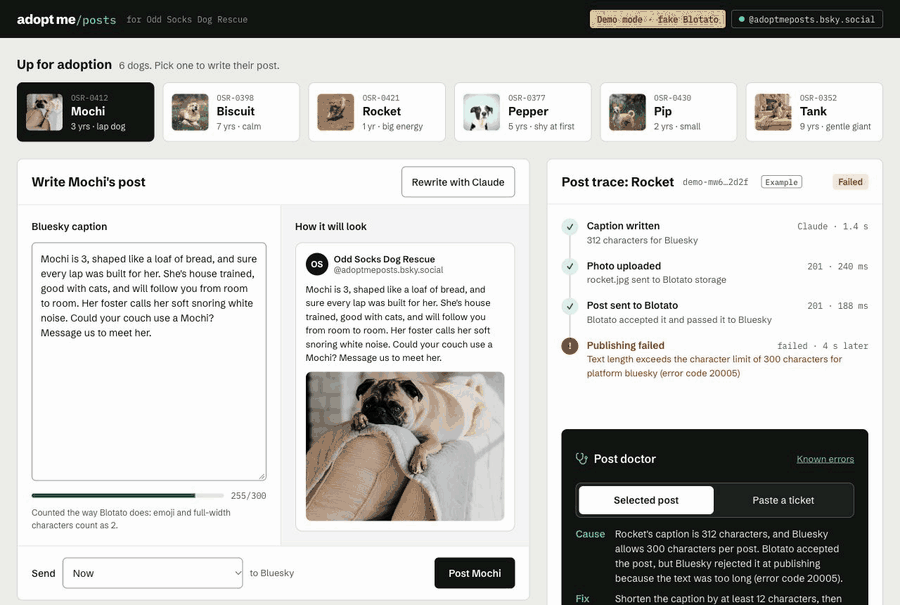
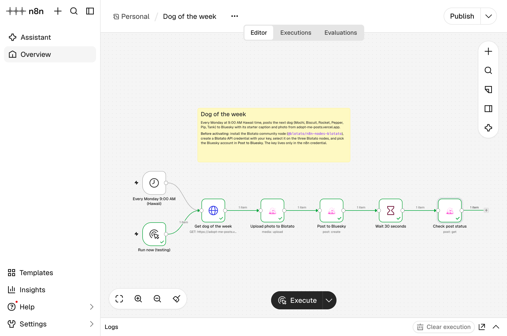
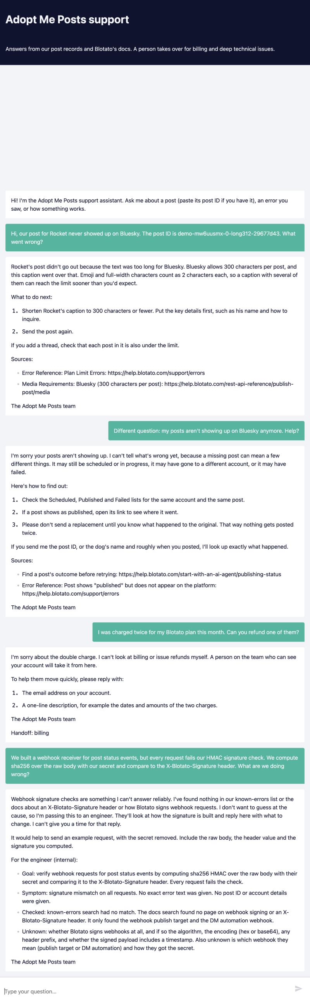

# Adopt Me Posts

A posting tool for a small dog rescue: it writes a Bluesky post for each dog, posts or schedules it through the [Blotato API](https://help.blotato.com), follows it to the end, and explains any failure in plain words with links to Blotato's docs.

**Live:** https://adopt-me-posts.vercel.app

**Demo video:** https://youtu.be/3MXjBFj5Fmk

**Real posts:** [@adoptmeposts.bsky.social](https://bsky.app/profile/adoptmeposts.bsky.social) on Bluesky, posted through Blotato from this app and the n8n workflow.

The live demo runs in demo mode. Run it locally with your own Blotato key to post for real.



## Try this first

1. **Open the live app.** Rocket's post has already failed. Read its trace on the right, then the **Post doctor** below it: the cause, the fix, a reply for the customer, and the Blotato pages it's based on.
2. **Click "Paste a ticket"** in the post doctor, pick an example like "Scheduled post not out yet", and click **Diagnose ticket**.
3. **Post a dog.** Pick one at the top, click **Post** (or schedule it), and watch the post go from In progress to Published in **All posts**.

## How it uses Blotato

The app's server talks to Blotato for four things: list the connected accounts, upload the dog's photo, create the post (now or scheduled), and check the post's status until it's published or failed. The Blotato key stays on the server and is never sent to the browser.

**Demo mode:** until a Blotato key is set, a stand-in answers instead of Blotato. It copies real Blotato's responses and error messages, checked against the real API, so the app works end to end without an account, and the yellow **Demo mode** badge in the header says so. The four example posts only appear in demo mode.

Captions and the post doctor use Claude (`claude-sonnet-5-5`). The post doctor only explains errors from [`docs/known-errors.json`](docs/known-errors.json), a list built from Blotato's docs where every entry links its source page ([Known errors page](https://adopt-me-posts.vercel.app/#known-errors)).

## Claude Code: MCP servers and skills

[`.mcp.json`](.mcp.json) adds two MCP servers (approve them in `/mcp` the first time):

- **`blotato-docs`** (`https://help.blotato.com/~gitbook/mcp`, public, no key): searches and reads Blotato's help pages, so answers come from the current docs.
- **`blotato`** (`https://mcp.blotato.com/mcp`): reads posts and accounts in your Blotato account. Its key comes from `BLOTATO_API_KEY` in your shell and is never written in the file.

Two skills:

- **`/post-doctor`**: give it a post ID or a customer's message, and it drafts the cause, fix and reply with source links, using the same rules as the app. It's read-only, and works in docs-only mode without a key.
- **`/docs-check`**: compares the known-errors list with Blotato's live docs. It runs daily (see below).

## n8n workflows

- **Dog of the week** ([`n8n/dog-of-the-week.json`](n8n/dog-of-the-week.json)): every Monday at 9:00 AM Hawaii time, it posts the next dog to Bluesky with Blotato's official n8n node, then checks the post once.

  

  *A test run that posted to Bluesky for real, through Blotato's n8n node.*

- **Support agent** ([`n8n/support-agent.json`](n8n/support-agent.json)): a chat support agent with three tools: look up a post, search known errors, and Blotato's docs MCP server. It answers everyday questions, hands billing to a person without guessing, and escalates very technical questions with a short note for an engineer.

<details>
<summary>Support agent screenshot and import steps</summary>



**Dog of the week:** install the community node `@blotato/n8n-nodes-blotato` (Settings > Community Nodes), import the file, add a **Blotato API** credential, select it on the three Blotato nodes, and pick the Bluesky account in **Post to Bluesky**. Try **Run now (testing)**, then activate.

**Support agent:** import the file, add an **Anthropic** credential on the **Claude Sonnet 5.5** node, activate, and open the chat URL from the **Customer chat** node. No Blotato key is needed.

Neither file contains a key; keys live only in n8n credentials.
</details>

## Daily docs check

A GitHub Action ([`.github/workflows/docs-check.yml`](.github/workflows/docs-check.yml)) runs `/docs-check` with Claude Code every day at 7:13 AM Hawaii time, plus a **Run workflow** button. Each run's summary shows any confirmed differences, anything it couldn't confirm, and the pages it opened for each entry. It opens or updates one `docs-drift` issue only for confirmed differences. The Claude step can only read, and a plain script writes the issue.

## What I found in Blotato's docs

Notes from building this, offered kindly. Blotato's docs are thorough, and these are small things that might be worth a look.

- **Uploading media first, or not?** The OpenAPI spec says post media "must originate from the blotato domain", while the [Media uploads and conversion](https://help.blotato.com/api-and-mcp-concepts/media-uploads-and-conversion) page says a public image URL can go directly in `mediaUrls` with no upload step. This app uploads first, which works either way. Source: [OpenAPI spec](https://backend.blotato.com/openapi.json).
- **Upload rate limit:** the [OpenAPI spec](https://backend.blotato.com/openapi.json) lists `POST /v2/media` at 10 requests a minute, while [Upload Media](https://help.blotato.com/rest-api-reference/publish-post/upload-media-v2-media) and [Plan and request limits](https://help.blotato.com/start-with-an-ai-agent/llm/limits) say 30.
- **Counting characters:** Blotato counts emoji and full-width characters as 2 toward the limit ([Error Reference, error code 20005](https://help.blotato.com/support/errors)), while Bluesky counts each visible character once ([Bluesky's post definition](https://github.com/bluesky-social/atproto/blob/main/packages/api/lexicons/app/bsky/feed/post.json), `maxGraphemes: 300`). So a post can fit Bluesky but not Blotato's check. This app counts the way Blotato does.
- **The too-long error is documented, just easy to miss:** error 20005 is listed under Plan Limit Errors in the [Error Reference](https://help.blotato.com/support/errors). A link from the [Bluesky](https://help.blotato.com/platform-publishing/platforms/bluesky) or [Media Requirements](https://help.blotato.com/rest-api-reference/publish-post/media) page could help people find it.
- **"Invalid account credentials"** appears as an example failed post in the [API reference for agents](https://help.blotato.com/start-with-an-ai-agent/llm), but isn't explained in the [Error Reference](https://help.blotato.com/support/errors). This app explains it with the closest documented case, "Account requires reconnect".
- **Unknown post IDs look stuck:** [Post lifecycle](https://help.blotato.com/api-and-mcp-concepts/post-lifecycle) says the status check returns `in-progress` when there's no record of an ID, while the [OpenAPI spec](https://backend.blotato.com/openapi.json) also lists a 404. A mistyped ID can look like a stuck post. In testing, real Blotato returned `in-progress` for made-up IDs, never 404.
- **No alt text for Bluesky images:** in the [OpenAPI spec](https://backend.blotato.com/openapi.json), `altText` is a target field for Instagram and Pinterest only, and the Bluesky target has no options. So images posted to Bluesky through the API reach screen reader users as just "image". An `altText` option for Bluesky (and other platforms that support it) would help rescues and others reach everyone.
- **One post, two IDs:** creating a post returns a `postSubmissionId` (a UUID), and the same post shows up in the post list with a different ID, which was numeric in our testing. [Accounts and identifiers](https://help.blotato.com/api-and-mcp-concepts/accounts-and-identifiers) does explain that these are separate IDs, but a customer comparing the dashboard with the API could easily think they're looking at two different posts. Showing the `postSubmissionId` next to the post in the dashboard, or returning it in the post list, could save some support questions.
- **A cautious reading in this app:** "emoji" isn't defined further, so this app also counts symbols like © as 2. That may count a little high, but it never says a post fits when Blotato would reject it.

## Suggested help articles

Three short customer-facing drafts written from Blotato's docs, each citing the pages it relies on. They're suggested drafts, not official Blotato articles.

- [Why did my Bluesky post fail when it looked under 300 characters?](docs/suggested/bluesky-post-over-300-characters.md)
- [My post says "in progress" for a long time. What should I do?](docs/suggested/post-stuck-in-progress.md)
- [What does "Invalid account credentials" mean, and how do I reconnect?](docs/suggested/invalid-account-credentials.md)

## Run it yourself

You'll need Node 24 and the [Vercel CLI](https://vercel.com/docs/cli).

```bash
git clone https://github.com/shaunadigital/adopt-me-posts.git
cd adopt-me-posts
npm install
cp .env.example .env.local
```

In `.env.local`, set `ANTHROPIC_API_KEY` for captions and the post doctor. Leave `BLOTATO_API_KEY` empty to stay in demo mode, or add your Blotato key to post for real. Then:

```bash
vercel dev
```

Open http://localhost:3000. `npm run test:demo` checks every route in demo mode, and `npm run build` checks types and builds.

## Credits

Dog photos are from Unsplash, and the fonts are Schibsted Grotesk and IBM Plex Mono; see [CREDITS.md](CREDITS.md). The code is under the [MIT License](LICENSE). The dogs and Odd Socks Dog Rescue are made up.

A sample app by Shauna Arnold · [shauna.dev](https://shauna.dev)
